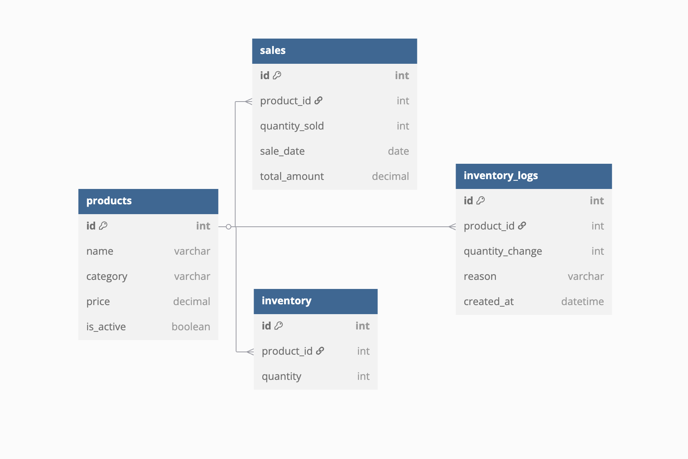
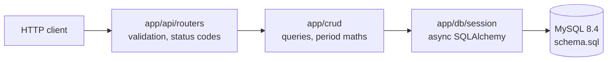

# Storefront admin API

A small FastAPI service for the back office of a shop: it records products, stock entries and sales in MySQL, and answers the revenue questions an admin asks most often (how much per day, week, month or year, per category, and compared with the previous period).

It is a scoped prototype. There is no frontend, no authentication, no checkout or payments, and recording a sale does not decrement stock. Every route is public, so do not expose it beyond your machine without adding an access policy first.



## Quick start (Docker Compose)

Requires Docker with Compose v2.

```sh
cp .env.example .env              # set MYSQL_PASSWORD to anything local
docker compose up -d --build --wait
docker compose exec api python -m demo_data --reset-demo   # optional sample data
```

The API is then on <http://127.0.0.1:8000> (change `API_PORT` in `.env` if the port is taken), with interactive docs at `/docs`. MySQL 8.4 applies `schema.sql` on its first start and keeps its data in the `mysql-data` volume; the database port is not published to the host.

`demo_data --reset-demo` **drops and recreates every table** before inserting four products, their stock, and a few sales dated today, yesterday and a week ago. Without the flag it refuses to run.

Stop with `docker compose down`, or `docker compose down -v` to also delete the database volume.

### Running on the host instead

Python 3.12 (see `.python-version`) and a MySQL database you control:

```sh
python3.12 -m venv .venv && . .venv/bin/activate
pip install -r requirements.txt
cp .env.example .env              # point DATABASE_URL at your database
mysql ... < schema.sql            # or set CREATE_SCHEMA=true for the first start
uvicorn app.main:app --host 127.0.0.1 --port 8000
```

Settings come from the environment or the root `.env` file: `DATABASE_URL` (required, an async SQLAlchemy URL such as `mysql+aiomysql://...`) and `CREATE_SCHEMA` (default `false`; when `true`, startup runs `create_all` for any missing tables). There are no migrations, so plan schema changes yourself before keeping real data.

## Endpoints

| Method and path | What it does |
| --- | --- |
| `GET /products/`, `POST /products/` | List products / create one (201; 409 if the name exists) |
| `GET /inventory/`, `POST /inventory/` | List stock entries, optionally `low_stock=true&threshold=N` / record an entry and its log line (201) |
| `GET /inventory/logs/{product_id}` | Stock log for one product, newest first |
| `GET /sales/`, `POST /sales/` | List sales, filtered by `start_date`, `end_date`, `product_id`, `category` / record one (201) |
| `GET /sales/summary?interval=day\|week\|month\|year` | Revenue per period |
| `GET /sales/summary_by_category` | Revenue per product category, optional date range |
| `GET /sales/compare?interval=day\|week\|month\|year` | Current period to date versus the whole previous period |

Lists take `skip` (0 or more) and `limit` (1 to 500) and are ordered by id. Date filters are inclusive, and a `start_date` after `end_date` is a 422. A stock entry or sale for a product that does not exist is a 404.

### Examples

Captured from the Compose stack after seeding demo data on 2026-11-09.

```http
POST /products/
{"name": "Desk lamp", "category": "Lighting", "price": "34.50"}

201 {"name": "Desk lamp", "category": "Lighting", "price": "34.50", "is_active": true, "id": 5}
```

```http
POST /products/            (same body again)

409 {"detail": "A product named 'Desk lamp' already exists"}
```

```http
POST /sales/
{"product_id": 5, "quantity_sold": 1, "sale_date": "2025-01-01", "total_amount": "1.005"}

422 {"detail": [{"type": "decimal_max_places", "loc": ["body", "total_amount"],
     "msg": "Decimal input should have no more than 2 decimal places", ...}]}
```

```http
GET /inventory/?low_stock=true&threshold=10

200 [{"product_id": 3, "quantity": 5, "id": 3}, {"product_id": 4, "quantity": 0, "id": 4}]
```

```http
GET /sales/summary?interval=week

200 [{"period": "2026-W45", "revenue": "109.94"}, {"period": "2026-W46", "revenue": "328.88"}]
```

```http
GET /sales/summary_by_category

200 [{"category": "Gadgets", "revenue": "359.83"},
     {"category": "Lighting", "revenue": "69.00"},
     {"category": "Tools", "revenue": "9.99"}]
```

```http
GET /sales/compare?interval=day

200 {"current_period_revenue": "328.88", "previous_period_revenue": "99.95", "change_percent": "229.04"}
```

```http
GET /sales/compare?interval=month       (nothing was sold last month)

200 {"current_period_revenue": "438.82", "previous_period_revenue": "0.00", "change_percent": null}
```

## Design notes



- **Money is never a float.** Prices and sale totals are `DECIMAL(10,2)` columns and Pydantic `Decimal` fields limited to two places, and every amount in a response, report totals included, is a decimal string quantized to cents. Clients should parse them as decimals.
- **Reporting periods are strings with fixed formats:** `2025-01-31`, `2025-W05` (ISO week, Monday start), `2025-01`, `2025`. Revenue is summed per day in SQL and rolled up in Python, so a week that spans New Year stays one bucket and the same code runs on MySQL and on SQLite in tests.
- **`/sales/compare`** compares the current period *to date* with the *entire* previous period, for example 1 to 9 November against all of October, so early in a period the change is usually negative. Future-dated sales are excluded. `change_percent` is `null` when the previous period had no revenue, because growth from zero is undefined. Periods follow the server's local date (UTC in the container).
- **Sales and stock are independent records.** A sale stores the quantity and total the caller supplies; it is not priced from the product and does not touch inventory. A stock entry writes one `initial stock` log line. The demo seeder adds illustrative sale log lines, but nothing enforces that logs add up to stock.
- `sales.sale_date` and `products.category` are indexed for the date-range and category filters.

## Tests

```sh
docker compose --profile test run --rm tests
```

This builds the image's `test` stage and runs the whole suite: 45 tests against in-memory SQLite (routes, validation, money rounding, period boundaries including leap years and ISO week 1, pagination order) plus 4 in `tests/test_mysql.py` that recreate the tables from `schema.sql` on a throwaway tmpfs MySQL 8.4 and check exact sums, week grouping and foreign-key and unique-name handling. Outside Compose the MySQL tests skip unless `TEST_MYSQL_URL` points at a disposable database.

With a local virtualenv: `pip install -r requirements-test.txt`, then `pytest -q` and `ruff check .`.

## Layout

```
app/
  api/routers/   products, inventory and sales routes
  crud/          database queries and reporting maths
  models/        SQLAlchemy tables
  schemas/       Pydantic request and response models
  core/config.py settings (DATABASE_URL, CREATE_SCHEMA)
  db/            engine, session factory, declarative base
demo_data.py     destructive demo seeder (--reset-demo)
schema.sql       MySQL DDL, applied by the Compose database on first start
tests/           pytest suite (SQLite, plus MySQL when configured)
```

## Before real use

Add authentication and authorisation, decide whether sales should be priced from the product and decrement stock, add versioned migrations, and choose the business time zone for reporting periods.

## License

MIT, see [LICENSE](LICENSE).
