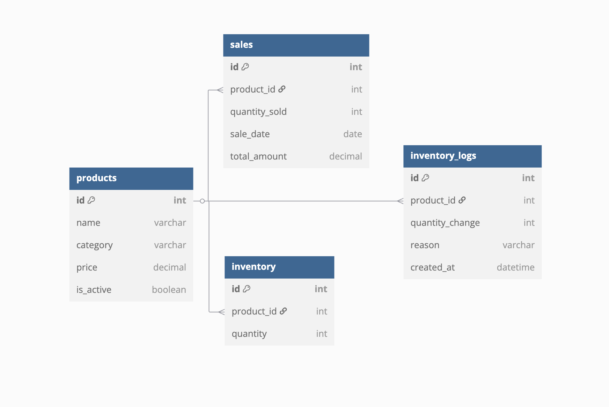

# Storefront admin API prototype

A FastAPI service for recording products, inventory entries, and sales, with SQL-based revenue summaries. The implementation targets MySQL through SQLAlchemy's asynchronous API. There is no frontend dashboard, authentication system, checkout, payment processing, or automatic inventory decrement.



The existing ERD is retained. Product, inventory, inventory-log, and sale models are separate: posting a sale records the supplied total and quantity; it does not calculate a price or reduce stock. Demo seed logs are illustrative and do not establish a stock ledger invariant.

## Local setup

Use Python 3.11+ and a disposable MySQL database. Dependencies are not fully locked.

```sh
python3 -m venv .venv
source .venv/bin/activate
pip install -r requirements.txt
cp .env.example .env
```

Set `DATABASE_URL` to your own local database credentials. The settings loader reads the root `.env`; it is ignored by Git. Set `CREATE_SCHEMA=true` only when deliberately initializing a disposable database, then run:

```sh
uvicorn app.main:app --host 127.0.0.1 --port 8000
```

Open `/docs` for the generated API reference. Startup no longer creates tables unless explicitly configured. `schema.sql` is a reference; no versioned Alembic migration setup is supplied. Plan migrations before maintaining real data.

**Destructive demo reset:** `python -m demo_data --reset-demo` drops/recreates tables and inserts sample data. The flag is required. This command was not run during review, and must never target a database you need to preserve. Normal server startup does not seed data.

## Requests and reporting

| Endpoint | Purpose |
| --- | --- |
| `GET/POST /products/` | List/create products; creation returns 201 |
| `GET/POST /inventory/` | List/create stock entries; optional `low_stock`/`threshold` filter |
| `GET /inventory/logs/{product_id}` | Initial-stock change logs |
| `GET/POST /sales/` | List/create recorded sales; filter by dates, product, or category |
| `GET /sales/summary?interval=day` | Revenue grouped by day/week/month/year |
| `GET /sales/summary_by_category` | Revenue totals per category |
| `GET /sales/compare?interval=month` | Current period-to-date versus full previous period |

List offsets are nonnegative and limits are 1–500. Product prices and sale totals are finite, nonnegative decimals with two decimal places; quantities cannot be negative and sold quantities must be positive. A synthetic product request is:

```json
{"name":"Example notebook","category":"Stationery","price":"12.50","is_active":true}
```

Revenue comparison excludes future-dated sales. Calendar periods use the server's local `date.today()`. The existing comparison uses an entire previous period, rather than matching elapsed days; that choice remains pending owner confirmation. When previous revenue is zero, `change_percent` retains the original zero convention, which must not be read as a mathematically defined growth rate. Reporting casts decimal totals to JSON floats; use a deliberate money serialization policy before financial use.

## Verification

```sh
pip install -r requirements-test.txt
python -m pytest -q
```

Thirteen tests pass in an isolated in-memory SQLite database. They exercise product/inventory/sale HTTP routes, daily and category summaries, current-period comparison excluding future sales, input constraints, and the fact that recording a sale leaves inventory unchanged. Test setup overrides the database URL before importing the app and inserts only synthetic fixtures. The original HTTPX test style was updated to `ASGITransport`, and the product test now expects the implemented 201 response.

The summary test uses the portable daily expression. MySQL-specific week/month/year functions, live MySQL constraints/transactions, the destructive seeder, deployment, and load behavior were not verified. All Python source parses; no user database was accessed.

## Engineering limits

The summary expression now checks `is None` instead of attempting to coerce a SQL expression to a boolean. SQL echo logging is disabled. Database connections are disposed at application shutdown. These changes improve the prototype but do not make it an authenticated admin service: every read/write route is still public if hosted. Add an access policy, predictable missing-product/duplicate errors, date-range validation, inventory invariants, and versioned migrations before exposing real business records. There is no public UI to improve or screenshot beyond the existing ERD and generated API documentation.
